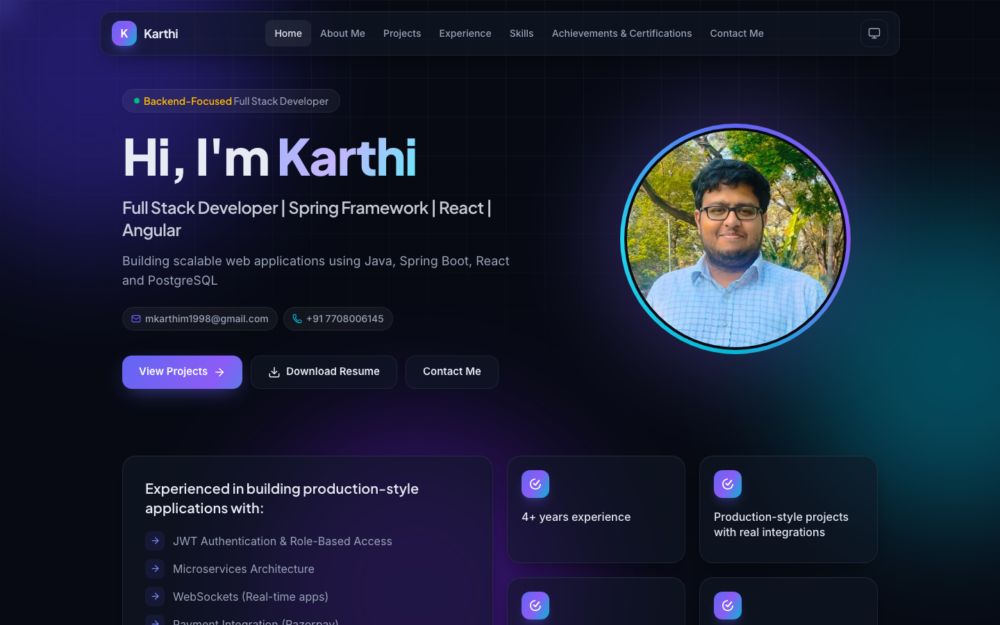
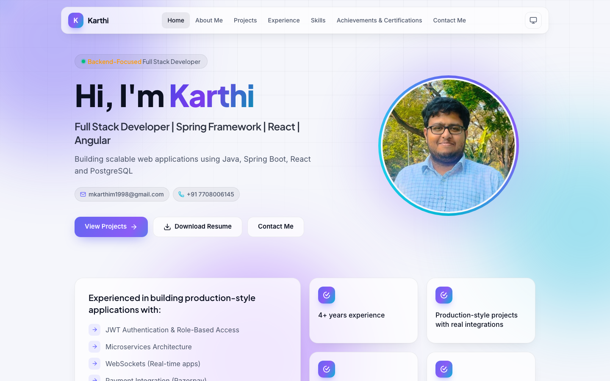
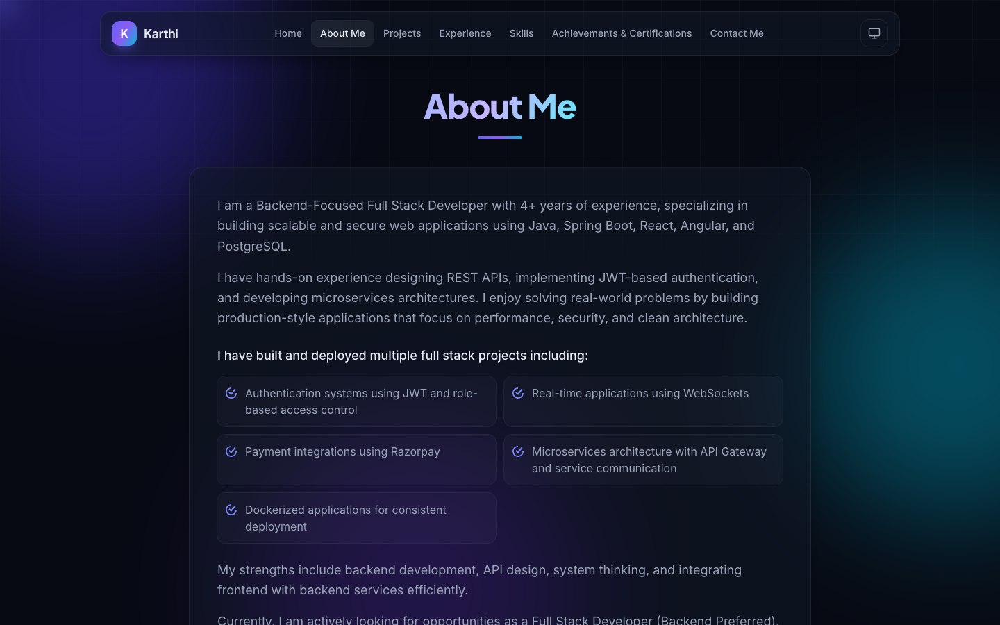
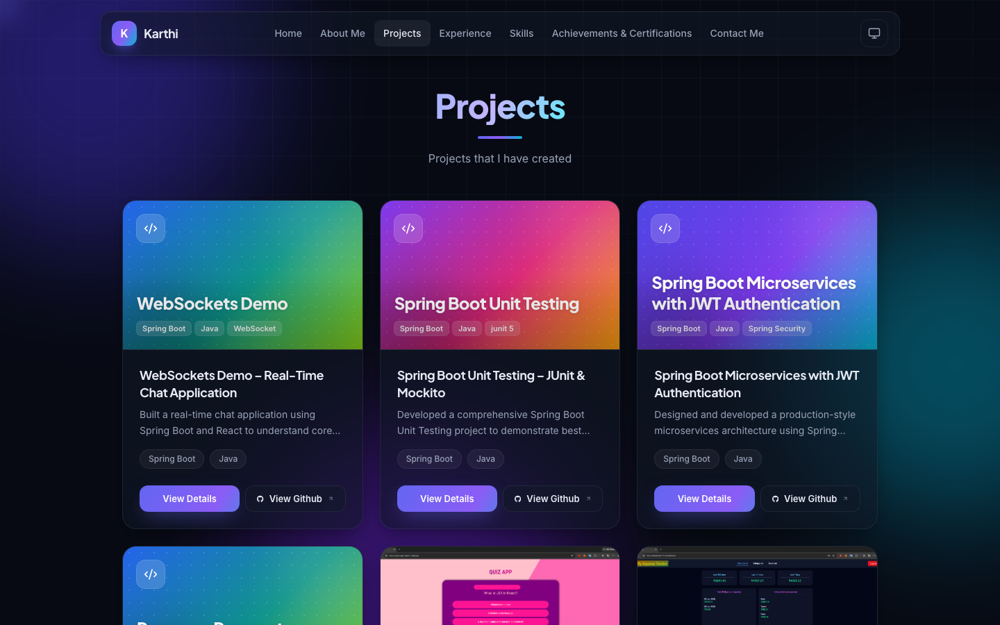
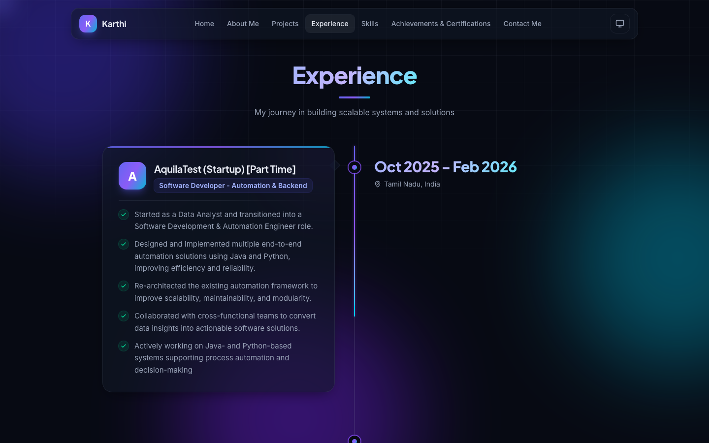
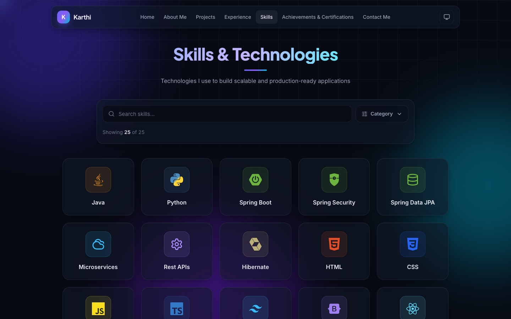
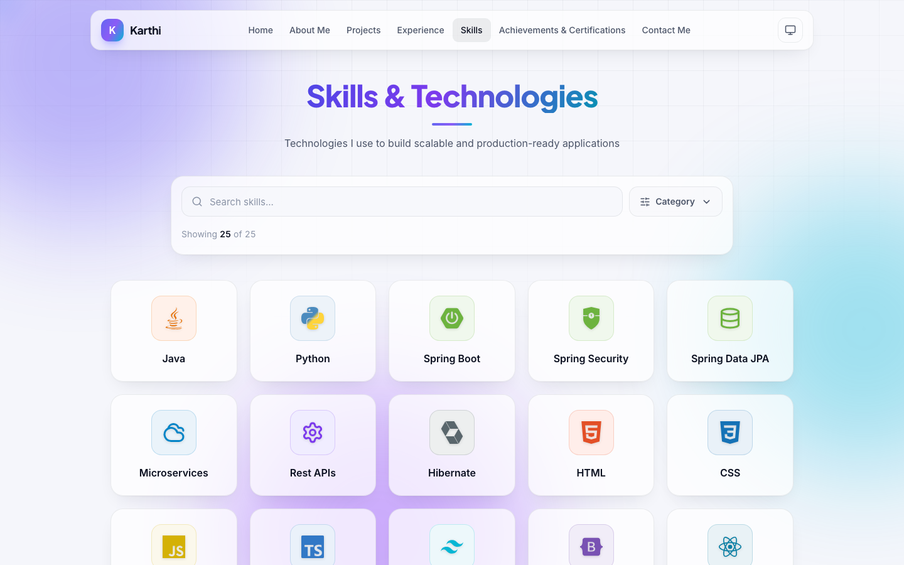
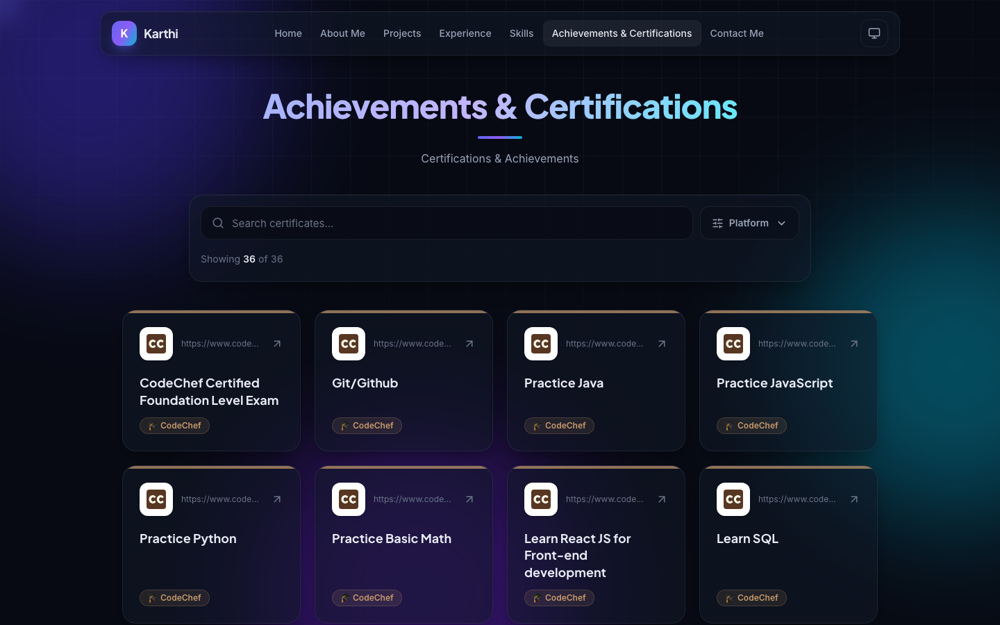
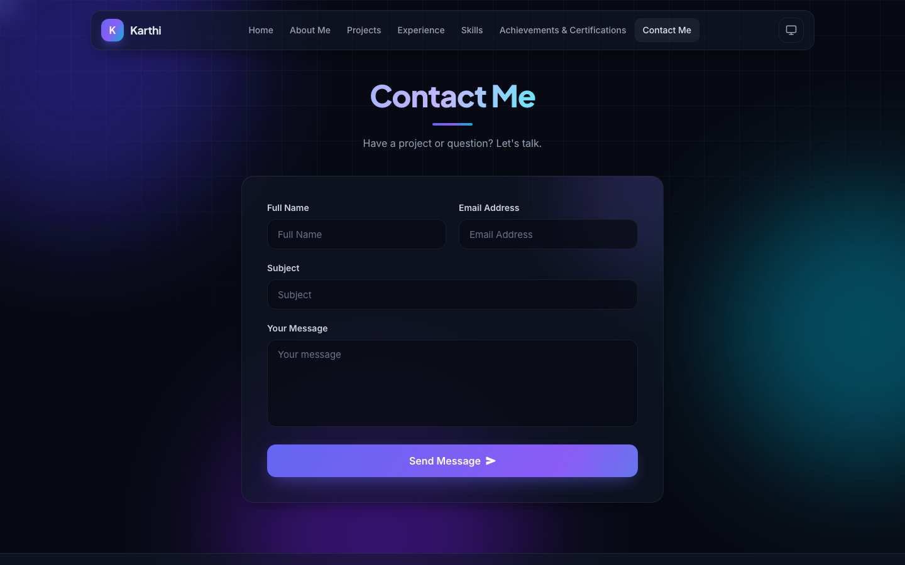
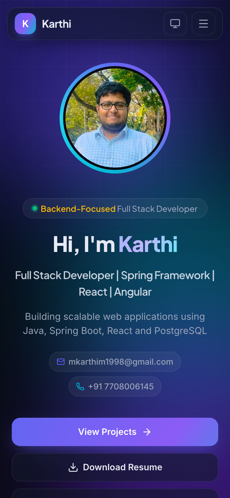

## Portfolio website

**Demo URL: https://karthi-22.web.app**

Personal portfolio of Karthi – Backend-Focused Full Stack Developer.

### Features
- **Light & dark theme** – follows the system theme by default; the navbar toggle switches System → Light → Dark and remembers the choice
- **Modern UI** – glass cards, gradient accents, animated background and smooth page animations
- **Projects** – cards with screenshots (or a generated cover when there are none) and a details modal with an image slider
- **Experience timeline** – alternating timeline that fills as you scroll
- **Skills & certificates filters** – search plus a multi-select filter; categories and platforms are built from the data automatically
- **Brand-colored icons** – every skill logo uses its original color, certificate platforms show their own icon
- **Contact form** – sends email through EmailJS, with spam protection
- **SEO & sharing** – page titles per route, meta description, link-preview image, sitemap and robots.txt
- **Fast** – each page is loaded only when opened; images are lazy-loaded
- **Responsive** – works on mobile, tablet and desktop

### Tech used
- TypeScript
- React
- Tailwind CSS
- Lucide React & React Icons (icons)
- React router dom
- Framer motion
- Swiper
- Email js
- Firebase Hosting (deployed by GitHub Actions on every merge to `main`)

### Run locally
```bash
npm install
npm run dev
```

Other scripts: `npm run build` (production build into `dist/`), `npm run preview` (serve the build), `npm run lint`.

### Environment variables
| Variable | Purpose |
| --- | --- |
| `VITE_EMAILJS_SERVICE_ID` | EmailJS service used by the contact form |
| `VITE_EMAILJS_TEMPLATE_ID` | EmailJS template used by the contact form |
| `VITE_EMAILJS_PUBLIC_KEY` | EmailJS public key |

### Updating content
All content lives in `src/data/`:
- **Skills** – `SkillsData.ts`. Any `category` works (e.g. `'AI/ML'`, `'Data Science'`); its filter option appears automatically.
  Brand colors for many tools (incl. TensorFlow, PyTorch, Pandas, NumPy, scikit-learn, …) are in `src/utils/SkillGlow.ts`.
- **Certificates** – `CertificatesData.ts`. Any `certificateProvider` works (e.g. `'Coursera'`, `'Kaggle'`); the filter shows it with the site's own icon.
  Platform colors are in `src/utils/CertificatesGlow.ts`.
- **Projects** – `ProjectsData.ts`. Screenshot links can be GitHub file links; projects without screenshots get a generated cover.
- **Experience** – `ExperienceData.ts`.

### Screenshots
- Home
  
- Home (light theme)
  
- About Me
  
- Projects
  
- Experience
  
- Skills
  
- Skills (light theme)
  
- Certificates
  
- Contact Me
  
- Mobile
  
